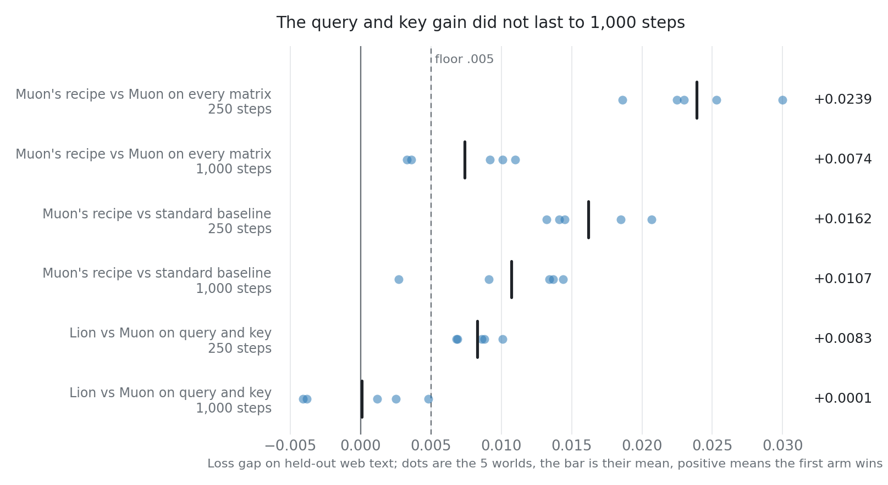
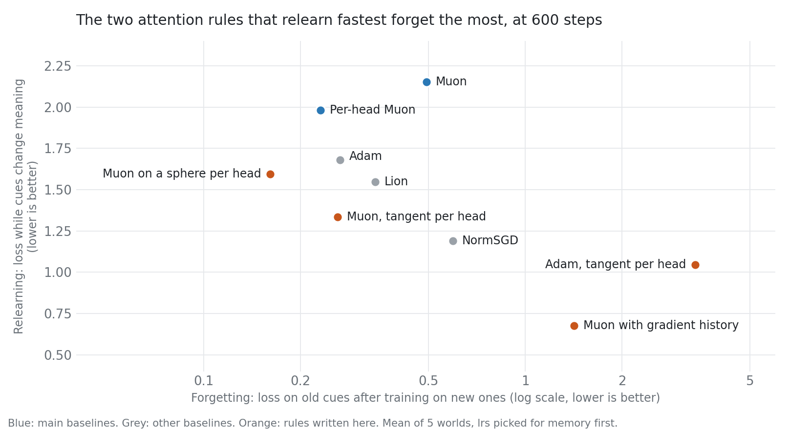

# Environment for researching a custom optimizer per LLM module

> [!IMPORTANT]
> We are using this environment to write a paper for ICML 2027. It was built in [AI Research School](https://www.skool.com/become-ai-researcher-2669), and you can use the code, results and ideas in your own research. The code is MIT licensed, and neither permission nor co-authorship is needed.
>
> **On a small LLM, two rules were enough: Adam on the embedding, head and norm scales, and Muon on hidden matrices. One rule on every matrix lost at both lengths we tested. A third rule on attention's query and key matrices helped at 250 steps, and that gain was gone at 1,000 steps.**
>
> **On attention alone, we wrote six new update rules. None beat both Muon and per-head Muon by the rule we wrote first. The closest, `muongate`, learns new things faster than Muon at 600 steps. At 2,400 steps it ties Muon on everything except relearning, where it won in 3 of 6 worlds and was level in the rest.**

| Paired gap in loss on held-out web text, over 5 worlds; positive means the first arm wins | 250 steps | 1,000 steps |
|---|---|---|
| **Muon's recipe vs Muon on every matrix** | **+.0239** (error .0020) | **+.0074** (error .0017) |
| **Muon's recipe vs the standard baseline** | **+.0162** (error .0015) | **+.0107** (error .0022) |
| Lion vs Muon on query and key | +.0083 (error .0012) | +.0001 (error .0018) |
| Rule search vs the best published recipe | +.0073 (error .0031) | +.0003 (error .0008) |



> [!WARNING]
> This is an early result from a model with 2 layers and width 48. The larger 1-minute tier was stopped, so the kill test's second required tier did not run, and the full win rule in `beat.py` has not been run. Larger models may differ.

> [!NOTE]
> An AI agent (Claude) wrote the code, ran the experiments and wrote this text. A second agent reviewed the code once ([review](reviews/review-1.md)). No person has reviewed the results.

---

## The core idea

An LLM learns by moving its weights a little after each batch of text. The formula that turns the gradient into that move is the **update rule**.

Most training uses one update rule for all weights. But weights do different jobs: an **embedding** is a table with one row per token, while an attention or MLP matrix transforms every token.

So recent papers give each kind of weight, each **module**, its own rule. **Muon** orthogonalizes the update of hidden matrices, and **RowNorm** normalizes each row of the update. These assignments are chosen by hand.

Each module can also have its own **learning rate (lr)**, the size of the move. A new rule can look better only because it got a better lr.

Our question: once every optimizer has one tuned lr per module, does each module need its own rule, or is one rule enough?

---

## Results

**Loss** is cross-entropy on web text the model never trained on, and lower is better. A **world** is a separate stretch of text with its own held-out rows. We count a gap as real only if its mean over worlds exceeds .005 and 2 errors. Every comparison uses one training run per setting per world.

### Use Adam on the embedding and head, and Muon on hidden matrices

Muon's recipe uses Muon on hidden matrices and Adam on the embedding, head and norm scales. The standard baseline uses Adam everywhere. Muon's recipe won in all 5 worlds at both lengths, by .0162 at 250 steps and .0107 at 1,000 steps.

We then swapped one module's rule at a time at 250 steps and measured the change in tune loss, with the lr of the new rule tuned on 3 to 5 values. Each module has a clear preference, except query and key.

| Module | Lowest loss | Next rule adds | Muon adds |
|---|---|---|---|
| Embedding | Adam | RowNorm +.018 | +.043 |
| Head | Adam | Muon +.0097 | +.0097 |
| Query and key | Lion | Adam +.0005 | +.0036 |
| Value and output | Muon | Hybrid +.0036 | best |
| MLP gate and up | Muon | Lion +.0029 | best |
| MLP down | Muon | Hybrid +.0027 | best |
| Norm scales | Adam | NormSGD on vectors +.0102 | can't run on vectors |

> **Apart from query and key, each module kept the rule Muon's recipe already gives it. These swaps start from that recipe with lrs tuned on 155 settings, which favours it.**

### Do not use one rule on every matrix

Muon on every matrix lost to Muon's recipe by .0239 at 250 steps and .0074 at 1,000 steps. The only change between them is Adam on the embedding and head. At 250 steps, Muon's recipe with tuned lrs and Lion on query and key beat Muon on every matrix by .0345, and Lion, RowNorm and NormSGD on every matrix by .0536, .0609 and .1061. Norm scales stayed on Adam in all of these arms, because these rules need matrices.

> **The gap shrinks with length, so this answer may change on longer runs.**

### Move query and key away from Muon only in very short runs

At 250 steps, four other rules on query and key each beat Muon, by .0056 to .0083, and they tie with each other. So the rule here is that query and key do not want Muon, and not that they want Lion. The gain also held on worlds 21 to 23, which no earlier run read: +.0090, error .0013.

At 1,000 steps Lion and Adam tie Muon there, at +.0001 and +.0010, and Muon has the lower tune loss.

Query and key also go through QK-norm. Without it, Lion's gain at 250 steps fell to +.0039, error .0015, but we did not test that drop with its own error, so QK-norm is not shown to be the cause.

> **Muon's recipe needs no third rule at 1,000 steps. We have not run the 250-step gain on a larger model.**

### One knob from Muon to a normalized gradient did not replace the two rules

We wrote one new rule, `softmuon`. It raises the singular values of the update to a power p, so p 0 is orthogonalization and p 1 is a normalized gradient. Query and key preferred p .75, while value and output preferred p near 0, where p .75 added .0305.

The best single p on all hidden matrices was .1. It lost to the design with Lion on query and key by .0114 on worlds 15 to 19 and by .0104 on worlds 21 to 23.

> **Hidden matrices disagree at 250 steps, so one p did not cover them.**

### Compare a new rule against lr tuning, or you may credit the rule for the lr

The rule search spent 218 settings at 250 steps and beat Muon's recipe by .0073. It put Lion on attention's query and key matrices and kept Muon or Adam elsewhere. A search over lrs alone spent 155 settings and tied Muon's recipe at +.0033. The search's remaining edge is .0040, positive in all 5 worlds and under our floor.

A later retest changed only query and key, from the lr-only design. It cleared the floor at +.0067, error .0011, on those same worlds, so the search's own design carried extra changes that gave nothing back.

> **At 250 steps about half of the rule search's gain came from lrs that needed no new rule.**

### Do not expect the 250-step winner to survive at 1,000 steps

At 1,000 steps the rule search spent 193 of its 219 settings on rules and moved no rule away from the best recipe, so Lion was gone. It tied that recipe at +.0003.

> **The best recipe itself changed with length: Muon's recipe led at 250 steps, and 2605.18106's recipe tied it at 1,000 steps (+.0037, error .0027).**

### Keep Adam on the embedding and head in short runs

RowNorm on the embedding and head lost to Adam by .0239 at 250 steps and tied it at 1,000 steps (−.0007, error .0023). The paper that proposes it reports gains at larger scale than we ran, so this does not contradict it.

### Run manifold rules for long enough before judging them

Keeping attention and MLP matrices on the Stiefel manifold lost to Muon's unconstrained recipe by .0338 at 250 steps. 2606.13276 reports its result at 50,000 steps on GPT-2 small, 200 times longer, and we did not run this rule at 1,000 steps.

### Do not expect a new attention rule to beat per-head Muon yet

Attention decides where a token looks. Each token makes a **query**, each earlier token makes a **key**, and matching pairs get read. We built a separate test for only the query and key matrices, with six tasks: copy a token, select the token after a cue, read the latest token, count the most common token, remember old cues after learning new ones, and relearn when the same cues change meaning.

**Query-key normalization** rescales queries and keys, so the size of those matrices does not change the output. Muon's step still makes them larger, and a larger matrix turns less per step. That gave us the idea for the new rules: remove the part of the step that only changes size, per attention head.

**`muonhistory`** does that and also divides the step by a running sum of past gradient directions. It was the fastest to relearn, and it forgot more:

| Rule, 600 steps, 5 worlds | Copy | Remember old cues | Relearn |
|---|---|---|---|
| Muon | 2.007 | .493 | 2.153 |
| **Per-head Muon** | **1.546** | **.231** | 1.980 |
| Muon with gradient history (`muonhistory`) | 1.952 | 1.421 | **.677** |

Lower is better. These are mean losses over 5 worlds no run had read, with one training run per setting in each world. Per-head Muon is already published. It beat Muon on copy and on reading the latest token, and tied the other scores.



> **At 2,400 steps every rule solves the tasks, `muonhistory`'s relearning gain over Muon is a tie (.030 vs .051), and its forgetting is much worse (6.388 vs .256).**

Per-head Muon's sources and the numbers for all rules are in [RESULTS.md](RESULTS.md).

### Treat Muon's growth in query and key as a hidden learning rate schedule

We removed one part of Muon at a time. With size held fixed, forgetting went from .381 to 4.487. With a falling learning rate added at that fixed size, the model matched Muon on every score, so the growth works as a schedule. Almost no growth happens without momentum: the size ended at 9.3 instead of 27.1.

That growth also starts during first learning, when the model still has most to learn. **`muongate`** lets a head grow only after its gradient stops agreeing with its momentum.

| Rule, 600 steps, 15 new worlds | Copy | Read latest | Remember old cues | Relearn |
|---|---|---|---|---|
| Muon | 1.905 | .912 | .325 | 1.984 |
| Per-head Muon | 1.833 | .746 | **.224** | 2.055 |
| **`muongate`** | **1.664** | **.695** | .344 | **1.813** |

> **`muongate` learns new things faster than Muon: it read the latest token better in all 15 worlds (+.218), with memory level. It did not clear any main score against per-head Muon, so it does not pass the win rule.**

At 2,400 steps on 6 worlds, `muongate` ties Muon on copy, selection, the latest token and memory. It still relearns better (+.379), because in 3 of the 6 worlds Muon had not finished relearning. The model with width 96 did not run.


---

## Where it stops working

- **Size.** The largest finished model has 2 layers and width 48, and hidden matrices hold only 37% of its weights. At 250 steps, training them is worth .103, 21 times the floor, so the test can see them matter. Our guess is that short runs favour rules with fast early progress.
- **Unfinished checks.** Hidden rows were never read, speed was not measured for designs, and the audit of other scores did not run. All verdicts use web-text loss only. `softmuon` uses an exact SVD, so it costs more per step than Muon.
- **Manifold rules** were tuned as baselines at 250 steps and were not in the search's menu.
- **Few worlds.** Five worlds detect gaps near .005 only when the spread between worlds is small.

---

## Is this new?

Partly. Choosing rules per module by hand is published. We did not find a rule search per module on transformers where every arm also tunes its lrs per module, but several close papers are unread, so that may exist. [RESULTS.md](RESULTS.md) lists what we did and did not read.

| Work | Rules differ by module | Rules are searched | Every arm tunes lrs per module |
|---|---|---|---|
| Muon | Yes, by hand | No | Not claimed |
| 2605.18106 | Yes, by hand, from symmetry theory | No | Not claimed |
| 2606.13276 | Yes, by hand | No | No, it shares hyperparameters |
| Modular Manifolds | Yes, by hand, on a small MLP | No | No, one norm budgets lrs |
| 2607.20486 OPTScientist | No, one rule for all matrices | Yes | No |
| **This repo** | **Yes** | **Yes** | **Yes** |

---

## Setup

```bash
pip install -r requirements.txt
python3 setup_data.py
python3 claims.py --tier 5s
python3 env.py --spec muon --tier 5s --world 7
```

`claims.py` reads the saved results and needs neither the data nor training. The last line trains one setting in about 10 seconds on one CPU core; `setup_data.py` downloads 392 MB.

- [RESULTS.md](RESULTS.md): per-world tables, controls, commands and literature.
- [EXPERIMENTS.md](EXPERIMENTS.md): the working log, with each prediction written before its run.
- [chart.py](chart.py) and [chart_attention.py](chart_attention.py) draw the charts. MIT licence; the downloaded data has its own licences.
